Working professional, contributing to open source.

`C++` `JavaScript` `HTML` &nbsp;·&nbsp; 24 public repos &nbsp;·&nbsp; on GitHub since Jan 2022

## Receipts

- **AMD Gaia** · [delete the unused code panel CSS](https://github.com/amd/gaia/pull/6859) · open
- **KanaDojo** · [restore themes removed from community-themes.json](https://github.com/lingdojo/kana-dojo/pull/33693) · open
- **AMD Gaia** · [remove nvm alias step from the Windows tab](https://github.com/amd/gaia/pull/6852) · open
- **KanaDojo** · [add new Tsuyu Drizzle theme](https://github.com/lingdojo/kana-dojo/pull/33690) · merged
- **MinIO JS** · [read AccessKeyId in IamAwsProvider credential responses](https://github.com/minio/minio-js/pull/1516) · open

What happened to the merged theme?

 

It merged, then a later merge from another PR accidentally removed it along with other themes. I traced that through the commit history and opened the fix listed above. Star counts belong to the projects.

Earlier team projects (8 PRs)

 

| Repository | Pull request | Status |
|---|---|---|
| vvsvipul/happy-heart-hub | [Hhh 20 jenkinsfile integration](https://github.com/vvsvipul/happy-heart-hub/pull/15) | Merged |
| vvsvipul/happy-heart-hub | [refactor dockerCompose file](https://github.com/vvsvipul/happy-heart-hub/pull/14) | Merged |
| vvsvipul/happy-heart-hub | [HHH-16-reduce-replica-to-1-and-enable-database-persistence-in-kubernetes](https://github.com/vvsvipul/happy-heart-hub/pull/12) | Merged |
| vvsvipul/happy-heart-hub | [Set Up Foundational Project Structure](https://github.com/vvsvipul/happy-heart-hub/pull/2) | Merged |
| vvsvipul/happy-heart-hub | [created repository](https://github.com/vvsvipul/happy-heart-hub/pull/1) | Merged |
| Atharv-V/DevOps-Project | [KEY-18 add jenkins file](https://github.com/Atharv-V/DevOps-Project/pull/2) | Merged |
| Atharv-V/DevOps-Project | [KEY-16 created interface](https://github.com/Atharv-V/DevOps-Project/pull/1) | Merged |
| vvsvipul/Space-Invaders-Gesture-Edition | [bug fix in client.py](https://github.com/vvsvipul/Space-Invaders-Gesture-Edition/pull/1) | Merged |

## Contributions

Yearly totals

 

| Year | Contributions |
|---|---|
| 2022 | 49 |
| 2023 | 30 |
| 2024 | 85 |
| 2025 | 0 |
| 2026 | 24 |

## Built

- **[Happy Heart Hub](https://github.com/ityashag/HappyHeartHub)** · heart-risk prediction and generative AI, deployed to scale under load
- **[Secured Socket Programming](https://github.com/ityashag/SOCKET_PROGRAMMING)** · private messaging and file sharing with end-to-end encryption
- **[CrewAI Projects](https://github.com/ityashag/crew.ai)** · 7 hands-on projects, from zero to multi-agent systems
- **[OpenAI Agents SDK Projects](https://github.com/ityashag/Open-AI-SDK)** · 7 practical projects, learning the SDK by building

## On my list

- [x] First merged PR in a popular open-source project: [KanaDojo #33690](https://github.com/lingdojo/kana-dojo/pull/33690)
- [x] Spotted a merge that wiped 5 themes from KanaDojo and [opened the fix](https://github.com/lingdojo/kana-dojo/pull/33693)
- [ ] First merge at [AMD Gaia](https://github.com/amd/gaia)
- [ ] First merge at [MinIO](https://github.com/minio/minio-js)
- [ ] First merged PR in a project with 10k+ stars

Numbers from the GitHub API, last updated 6 Nov 2026.
